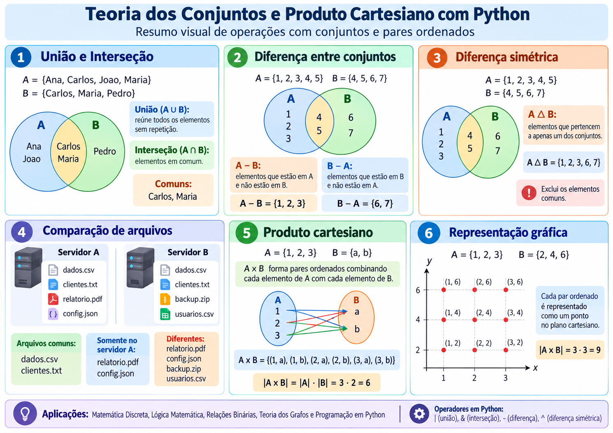

## Teoria dos Conjuntos e Produto Cartesiano com Python



**Figura 1 – Operações com conjuntos e representação do produto cartesiano utilizando Python.**

O infográfico apresenta os principais conceitos da **Teoria dos Conjuntos**, incluindo união, interseção, diferença, diferença simétrica e produto cartesiano. São demonstradas aplicações práticas em Python, como a identificação de usuários comuns entre sistemas, a comparação de arquivos armazenados em servidores e a geração de pares ordenados. Também é apresentada a representação gráfica do produto cartesiano no plano cartesiano, permitindo relacionar conceitos matemáticos com programação, relações binárias e Teoria dos Grafos.


# Teoria dos Conjuntos e Produto Cartesiano com Python

## Descrição

Este repositório apresenta seis exemplos práticos desenvolvidos em Python para demonstrar conceitos fundamentais da **Teoria dos Conjuntos**, incluindo união, interseção, diferença, diferença simétrica e produto cartesiano.

Os programas permitem relacionar os conceitos matemáticos com aplicações computacionais, como comparação de usuários, organização de arquivos e representação gráfica de pares ordenados.

## 1. Code-01.py: União e interseção de conjuntos

O programa apresenta dois conjuntos de usuários cadastrados em sistemas diferentes. O operador `|` realiza a **união**, reunindo todos os usuários sem repetição, enquanto o operador `&` realiza a **interseção**, identificando os usuários presentes nos dois sistemas.

**Operações utilizadas:**

- União: `A | B`
- Interseção: `A & B`

**Resultados:**

- União: Ana, Carlos, Joao, Maria e Pedro.
- Interseção: Carlos e Maria.

**Aplicação:** comparação de cadastros, identificação de usuários comuns e integração de registros entre sistemas.

## 2. Code-02.py: Diferença entre conjuntos

O programa demonstra a operação de **diferença entre conjuntos**, utilizando o operador `-`. Essa operação identifica os elementos existentes em um conjunto que não pertencem ao outro.

**Operações utilizadas:**

- `A - B`: elementos exclusivos do conjunto A.
- `B - A`: elementos exclusivos do conjunto B.

**Resultados:**

- `A - B = {1, 2, 3}`
- `B - A = {6, 7}`

**Aplicação:** identificação de elementos exclusivos em listas, cadastros e grupos de informações.

## 3. Code-03.py: Diferença simétrica

O programa utiliza o operador `^` para calcular a **diferença simétrica** entre dois conjuntos. Essa operação reúne os elementos que pertencem exclusivamente a um dos conjuntos, excluindo aqueles presentes em ambos.

**Operação utilizada:**

`A ^ B`

**Resultado:**

`{1, 2, 3, 6, 7}`

**Aplicação:** identificação de diferenças entre conjuntos de dados, comparação de registros e verificação de informações não compartilhadas.

## 4. Code-04.py: Comparação de arquivos entre servidores

O programa demonstra uma aplicação prática da Teoria dos Conjuntos na comparação de arquivos armazenados em dois servidores.

São realizadas três operações:

- **Interseção (`&`):** identifica arquivos presentes nos dois servidores.
- **Diferença (`-`):** identifica arquivos existentes somente no servidor A.
- **Diferença simétrica (`^`):** identifica arquivos presentes em apenas um dos servidores.

**Resultados:**

| Operação | Arquivos identificados |
|---|---|
| Interseção | `dados.csv`, `clientes.txt` |
| Diferença A - B | `relatorio.pdf`, `config.json` |
| Diferença simétrica | `relatorio.pdf`, `config.json`, `backup.zip`, `usuarios.csv` |

**Aplicação:** comparação de diretórios, conferência de backups e identificação de diferenças entre listas de arquivos. O programa compara os nomes dos arquivos, não seus conteúdos.

## 5. Code-05.py: Produto cartesiano entre conjuntos

O programa apresenta a construção do **produto cartesiano** entre dois conjuntos, utilizando dois laços de repetição `for`.

Cada elemento do conjunto A é combinado com todos os elementos do conjunto B, formando pares ordenados.

**Conjuntos utilizados:**

`A = {1, 2, 3}`

`B = {"a", "b"}`

**Resultado:**

```text
A × B = {
    (1, a), (1, b),
    (2, a), (2, b),
    (3, a), (3, b)
}
```

A quantidade de pares ordenados é determinada pelo produto das quantidades de elementos dos conjuntos:

`|A × B| = |A| × |B| = 3 × 2 = 6`

**Aplicação:** construção de relações matemáticas, combinação de elementos e introdução aos conceitos de relações binárias e Teoria dos Grafos.

## 6. Code-06.py: Representação gráfica do produto cartesiano

O programa demonstra a representação gráfica dos pares ordenados de um produto cartesiano utilizando as bibliotecas **Matplotlib** e **itertools**.

A função `product()` gera as combinações entre os conjuntos. Em seguida, a função `scatter()` representa cada par ordenado como um ponto no plano cartesiano.

**Conjuntos utilizados:**

`A = {1, 2, 3}`

`B = {2, 4, 6}`

**Produto cartesiano:**

```text
A × B = {
    (1, 2), (1, 4), (1, 6),
    (2, 2), (2, 4), (2, 6),
    (3, 2), (3, 4), (3, 6)
}
```

**Quantidade de pares ordenados:**

`|A × B| = 3 × 3 = 9`

O gráfico apresenta nove pontos, identificados por suas coordenadas `(x, y)`.

**Aplicação:** visualização de pares ordenados, estudo do plano cartesiano, relações matemáticas e introdução à geometria analítica.

## 7. Resumo dos códigos

| Código | Conteúdo | Recurso utilizado |
|---|---|---|
| Code-01.py | União e interseção | `\|` e `&` |
| Code-02.py | Diferença entre conjuntos | `-` |
| Code-03.py | Diferença simétrica | `^` |
| Code-04.py | Comparação de arquivos | `&`, `-` e `^` |
| Code-05.py | Produto cartesiano | Laços `for` |
| Code-06.py | Produto cartesiano e representação gráfica | `product()` e `matplotlib` |

## 8. Tecnologias utilizadas

- **Python:** linguagem utilizada no desenvolvimento dos programas.
- **Google Colab:** ambiente de execução dos códigos Python.
- **Matplotlib:** biblioteca utilizada para construir gráficos.
- **itertools:** módulo da biblioteca padrão do Python utilizado para gerar combinações de elementos.

## 9. Objetivo didático

Os exemplos têm como objetivo relacionar a fundamentação matemática da Teoria dos Conjuntos com aplicações práticas de programação.

Os alunos poderão modificar os conjuntos, executar os programas, interpretar os resultados e compreender como operações matemáticas são utilizadas na organização, comparação e representação de informações em sistemas computacionais.

Os exemplos também oferecem uma base para o estudo de **Lógica Matemática, Matemática Discreta, Relações Binárias e Teoria dos Grafos**.
